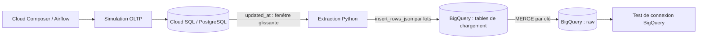

# Pipeline e-commerce batch sur Google Cloud

Un projet de data engineering qui simule une activité e-commerce dans PostgreSQL, extrait les changements et les consolide dans BigQuery avec un DAG Airflow quotidien.

**Statut : version de portfolio issue d'une récupération documentée.** Le DAG est conservé à l'identique. Les schémas SQL proviennent de transcriptions vérifiées sur captures. La configuration d'exemple, les tests et cette documentation ont été ajoutés pour la publication. Une nouvelle exécution complète dans le cloud reste à réaliser.

## Architecture



Le transfert est direct entre PostgreSQL et BigQuery. Un bucket GCS a été créé dans le projet historique, mais ce DAG ne l'utilise pas pour transférer les données. Les couches `staging` et `analytics` ne sont pas implémentées ici. Les tables de chargement se trouvent dans `raw`.

## Ce que démontre le projet

- Simulation de quatre entités : clients, commandes, lignes de commande et paiements.
- Timestamps métier fondés sur la date logique Airflow, pour rejouer une journée historique.
- Extraction de J−7 à J+1 exclus, soit huit journées calendaires incluant J.
- Chargement par lots de 5 000 lignes, puis `MERGE` sur les identifiants métier.
- Prise en compte de mises à jour de commandes et paiements dans une fenêtre bornée.
- Orchestration de six tâches avec un seul run actif et deux retries par tâche.

Le DAG `capstone_ecom_batch_v1` utilise `@daily`, `catchup=False` et démarre en pause lors de sa création. Son contrôle final exécute seulement `SELECT CURRENT_TIMESTAMP()` : ce n'est pas un contrôle de qualité des données.

## Résultats historiques observés

Le journal du 29 août 2026 rapporte **7 runs terminés, 42 tâches réussies et 0 échec**. Les contrôles BigQuery conservés affichent :

| Table | Lignes observées |
|---|---:|
| customers | 4 850 |
| orders | 19 400 |
| order_items | 38 800 |
| payments | 13 580 |

Ces volumes comprennent des données préexistantes. Ils ne sont pas le résultat attendu d'un backfill de sept jours sur une base vide. Le contrôle d'unicité retrouvé précède le dernier backfill ; l'absence de doublons après celui-ci n'est pas établie. Voir [les résultats et leurs limites](docs/results.md).

## Parcourir le dépôt

| Chemin | Contenu |
|---|---|
| `dags/` | DAG complet retrouvé, sans modification |
| `sql/postgres/001_schema.sql` | Quatre tables, contraintes et sept index explicites |
| `sql/bigquery/001_raw_tables.sql` | Tables `raw`, partitionnement et clustering |
| `sql/bigquery/002_quality_checks.sql` | Contrôles ajoutés pour une future validation |
| `config/env.example.sh` | Exemple de configuration sans secret |
| `scripts/render_sql.py` | Substitution locale des identifiants dans les SQL |
| `tests/` | Tests isolés sans dépendances cloud |
| `docs/setup.md` | Préparation et validation d'une nouvelle exécution |
| `docs/provenance.md` | Origine des fichiers et limites de récupération |
| `docs/limitations.md` | Limites techniques et améliorations possibles |

## Vérifier localement

Python 3.11 ou supérieur suffit pour ces contrôles hors ligne, qui n'installent ni Airflow ni les clients cloud :

```bash
python -m unittest discover -s tests -v
python -m compileall -q dags scripts tests
bash -n config/env.example.sh
python scripts/render_sql.py sql/bigquery/001_raw_tables.sql --project demo-ecommerce-project
```

Les tests exécutent les fonctions métier isolées avec des connexions simulées. Ils ne valident ni l'import réel du DAG dans Airflow, ni les dialectes SQL sur les serveurs, ni le comportement de BigQuery. Le workflow GitHub Actions reprend ces vérifications ; son résultat distant sera connu après publication.

Pour préparer le cloud, suivre le [guide de mise en route](docs/setup.md). Aucun script de ce dépôt ne provisionne automatiquement Cloud SQL ou Composer.

## Configuration et publication

Les mots de passe, clés de comptes de service et exports de connexions restent hors du dépôt. Les captures et conversations sources ne sont pas publiées. Le projet d'origine et les identifiants personnels ont été exclus des fichiers destinés à GitHub.

Aucune licence de réutilisation n'est ajoutée à ce stade ; le choix doit tenir compte de la provenance pédagogique du code. La publication du dépôt ne constitue pas une autorisation de réutilisation sous une licence libre.
